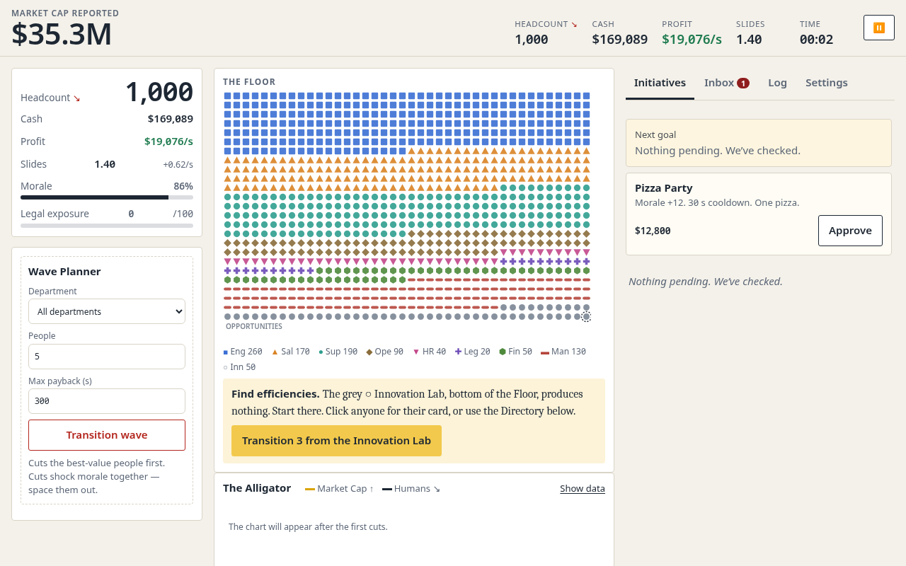
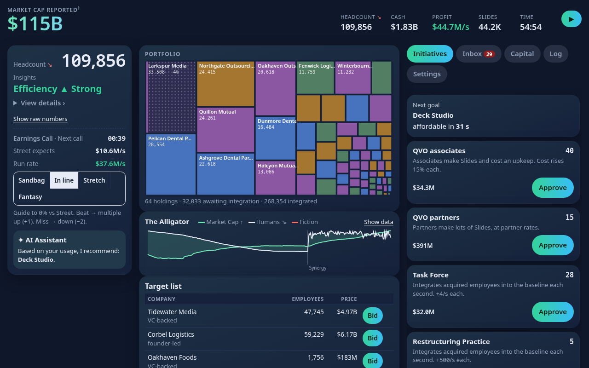

# NATURAL ATTRITION

A satirical incremental game about headcount, "efficiency" and what happens when the thing you optimise is the thing that was paying for it.
Inspired by the *shape* of Universal Paperclips (one number, four acts, a slow reveal of what the game is really about), with its own jokes, systems and endings.

**Play:** https://tonimalt-af.github.io/natural-attrition/ · ~2 hours start to finish, about 95–125 min when played actively. It saves automatically and also earns a little while you are away.

 

No images, no audio, no external requests: everything is drawn with `<canvas>`, SVG and CSS. ~50 kB gzipped.

## The game in one paragraph

You are Employee #1000 at a 1,000-person company, handed the "Efficiency Initiative". **Act I** – cut people (but watch who actually holds the place together), approve "initiatives", beat quarterly Street expectations. **Act II** – the Initiative becomes a holding company; buy other companies, integrate them, and keep the books *looking* good with debt, add-backs and "fiction" while the real number quietly diverges (hold **R** for the Reality Lens). **Act III – The Rehire** – the market has stalled because you cut the people who were the customers. Re-engage the real people you let go in Act I, as contractors at 3× the cost, while Demand rises and the Board punishes every single rehire; the first person you ever cut comes back last, as Head of Efficiency. **Act IV** – the Redundancy Review turns on the Initiative itself, run by that same Head of Efficiency; the verdict reflects how you behaved in Act I.

### Twists (each has a *Stable UI* fallback)
T1 the Alligator chart · T2 boomerang consultants & scope creep · T3 the interface decays as departments are cut · T4 the forced "We've updated the experience!" redesign (with a Classic revert) · T5 Reality Lens · T6 The Rehire (Re-engagement Desk, Demand vs Board) · T7 Act IV dismantles the UI · T8 your own Performance Review stats.

### Cycle 5 mechanics
- **Strategic Deck**: converts surplus Slides to capped cash (15 s cooldown); **value-based pricing** caps most initiative cash costs at a few minutes of profit; associates are capped (12 in Act I, 40 later).
- **Day-1 synergies and integration waves**: each acquisition loses 30–55% of its roles at closing; the rest integrate in 20 s waves across all open blocks in parallel. The HQ block shows humans versus roles.
- `node tools/deadtime.ts modes seeds [--md]` reports dead stretches for the headless bots (greedy, lazy, aggressive, clicky).

## Controls
Mouse/touch everywhere; keyboard works for all buttons (Tab/Space/Enter). **Space** pauses, **R** (hold) shows reality. The Settings tab has: **Stable UI** (turns off every UI-surprise twist; auto-on with `prefers-reduced-motion`), reduced motion, high contrast, text size, offline cap, Classic layout, export/import/copy save, and a typed-RESIGN reset.

## Saving
`localStorage` only, key prefix `natural-attrition:v1:`. Checksummed envelope, 3 rolling backups with automatic restore, versioned migrations, and portable export (`G1.` gzip+base64url) / import. Nothing leaves your browser. There is no analytics.

## Develop
```
npm ci
npm run dev        # Vite dev server  (add ?debug=1 for the IT Console, ?seed=N for a fixed company)
npm run typecheck && npm test
npm run build      # -> dist/, deployed by .github/workflows/deploy.yml (GitHub Pages)
node tools/bot.ts greedy 200 1 5   # headless pacing bot: mode, max minutes, seed, trace interval (min)
node tools/fixtures.ts             # regenerate public/fixtures/*.nasave (act checkpoints used by the e2e runs; rerun after any schema change)
npm run e2e                        # Playwright (system Chrome) screenshots at 1280x800 and 390x844 -> shots/
node e2e/play.mjs                  # UI-driven flows (cut, buy, Act I->II, bid, Act IV -> both endings)
node e2e/a11y.mjs                  # axe-core (WCAG A/AA) on several scenes, keyboard, reduced-motion
```
Stack: TypeScript, Preact, Vite, Vitest. The simulation is a deterministic fixed-step engine (`src/engine/`, seeded mulberry32 stored in the save), separate from the UI (`src/ui/`). `docs/SPEC.md` is the design document; `PLAYTEST.md` logs the playtest cycles.

Tests: determinism, save round-trip/CRC/backup/migration/import-export, offline cap & no-hazards, formatters, and a **pacing regression** (greedy bot per act inside the spec windows, lazy bot ≤ 180 min, idle never walled).

## Deviations from SPEC.md (honest list)
Plain `number` instead of a big-number lib (values stay < 1e20) · fixed 0.25 s tick · audit thresholds start at $20B · simplified acquisition targets (no fat/keeper density) · no ×2 milestone multipliers at 10/25/50 owned · Act III money is held in π0-seconds (`pi0`, snapshotted at Act III start) so the late game can't be soft-locked or trivialised · no sound (the setting exists but is inert) · no Case Files/Playbook screen · English only · no multi-tab guard · offline progress runs on the main thread · no Konami easter egg.
